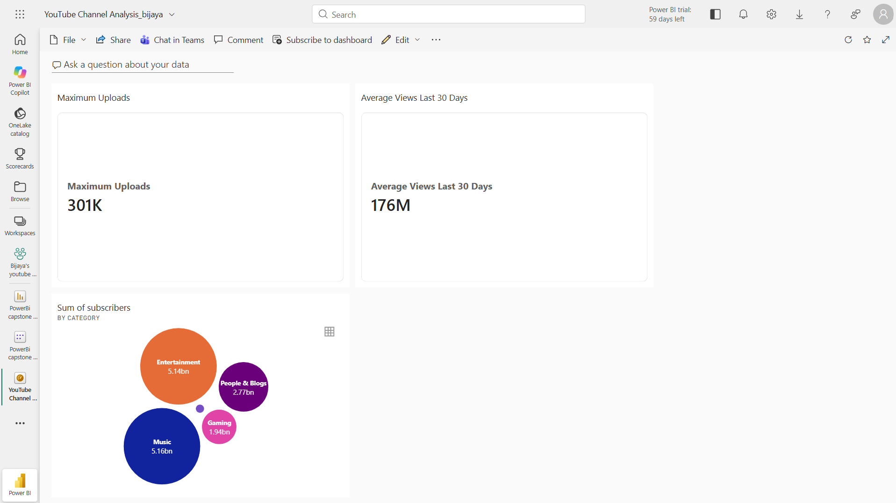

# YouTube Channel Analytics Dashboard

## Project Overview
This project focuses on analyzing YouTube channel data using Microsoft Power BI. The dashboard presents key performance indicators and visual insights related to uploads, views, and subscriber distribution across different categories.

## Project Objectives
- Analyze YouTube channel performance.
- Understand upload and view metrics.
- Visualize subscriber distribution across categories.
- Present data through clear and informative visualizations.

## Tools & Technologies
- Microsoft Power BI
- Data Visualization
- Dashboard Design

## Dashboard Preview

## Key Metrics Displayed
- Maximum Uploads: 301K
- Average Views Last 30 Days: 176M
- Sum of Subscribers by Category

## Project Files

### 1. Power BI Project File
[View / Download Power BI Project (.pbix)](PowerBi%20capstone%20project.pbix)

### 2. Project Visualizations
[View / Download PDF – 15 Power BI Visualizations](PowerBi%20capstone%20project.pdf)

### 3. Dashboard Screenshot
[View Dashboard Screenshot](dashboard_overview.png)

## Project Outcome
Created a Power BI dashboard to present YouTube channel performance metrics and category-wise subscriber insights through data visualization.

## Author
**Bijaya Munshi**

GitHub: [bmcoderea](https://github.com/bmcoderea)
